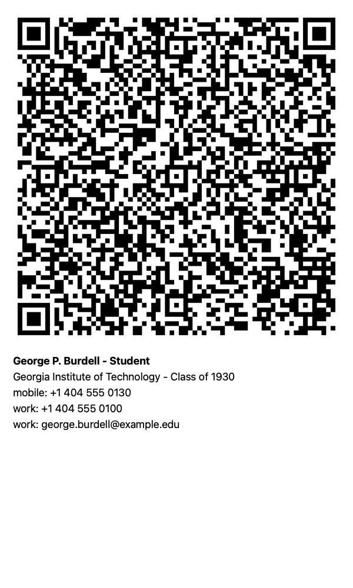
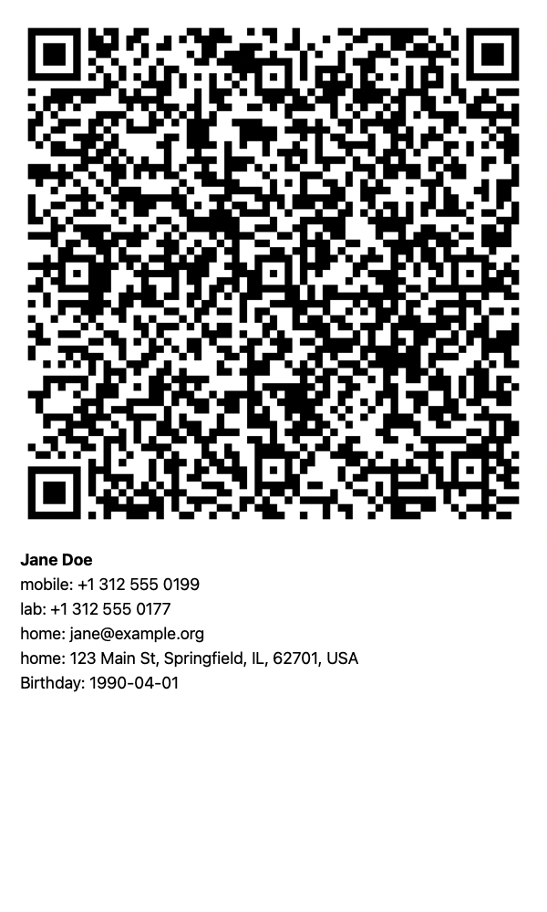
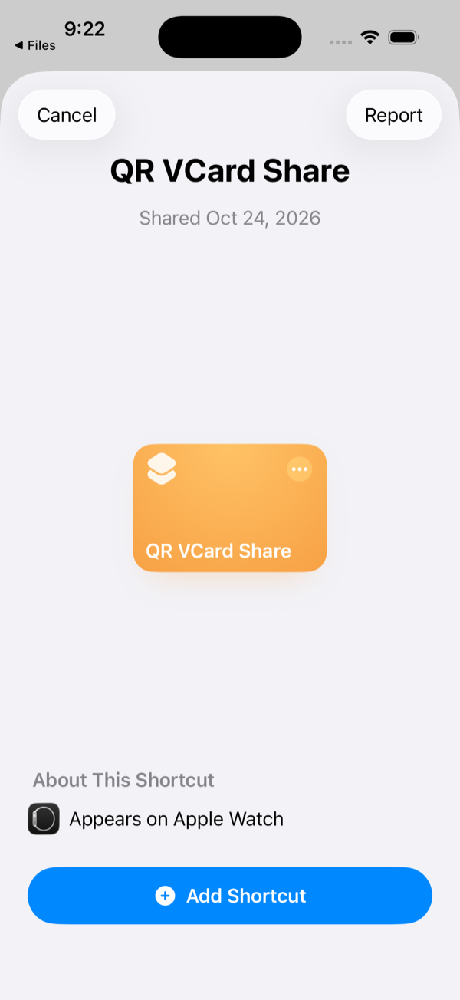
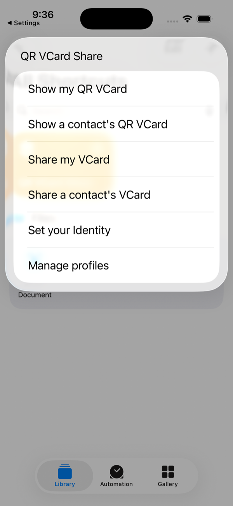
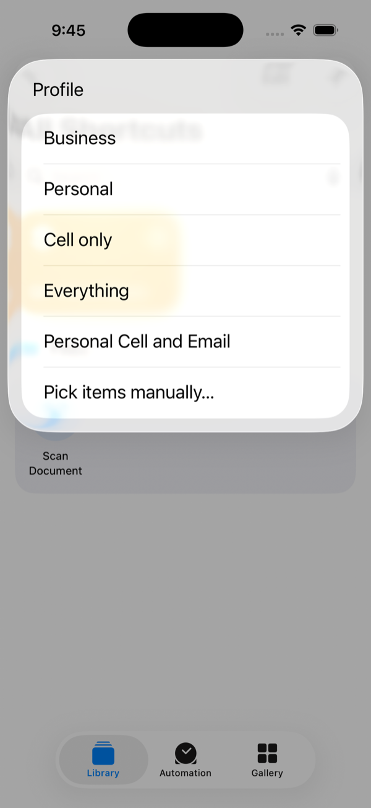
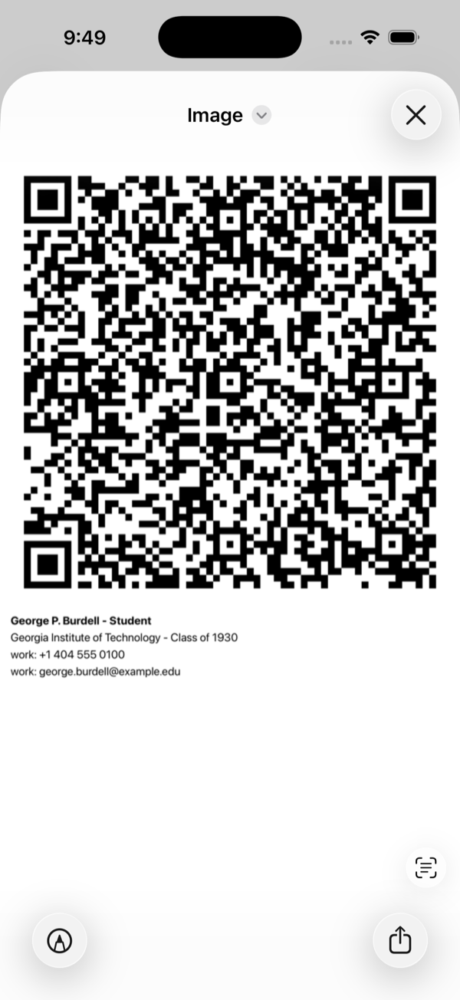
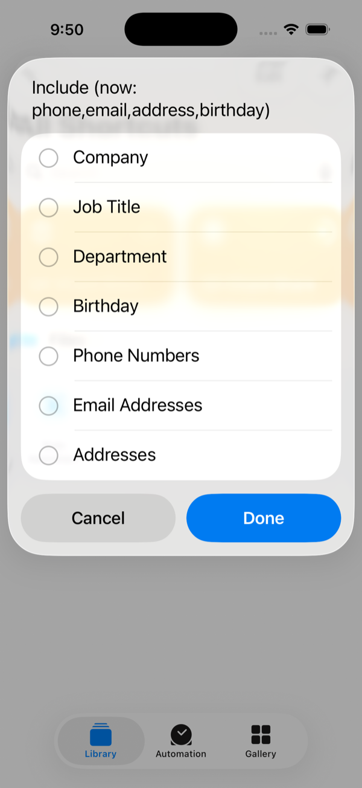
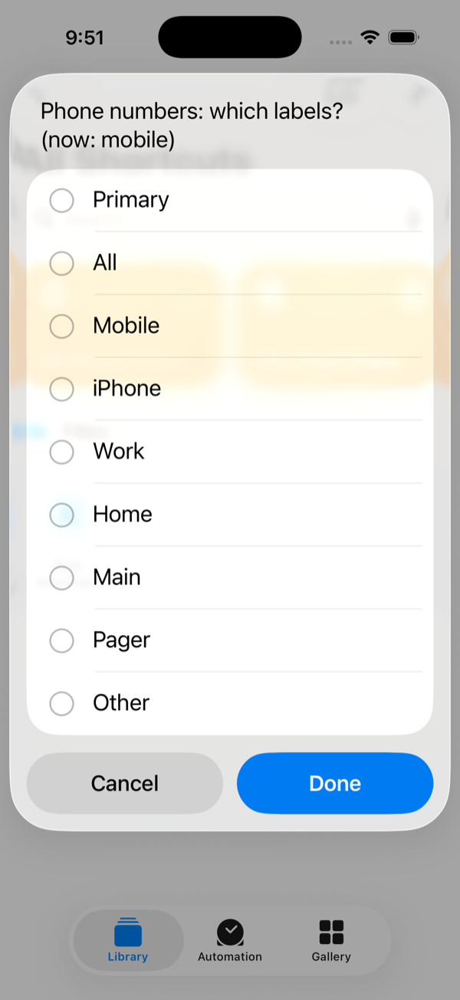
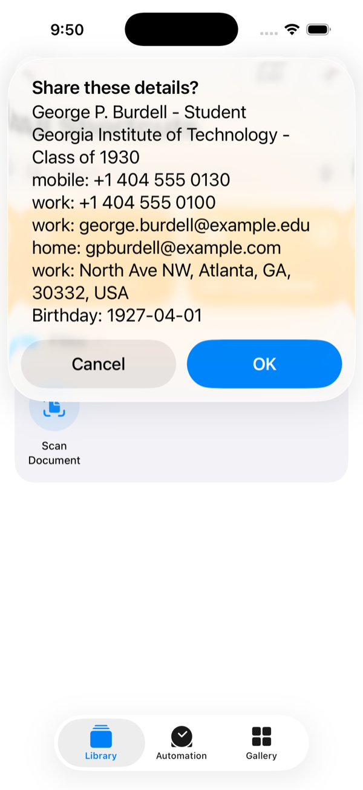
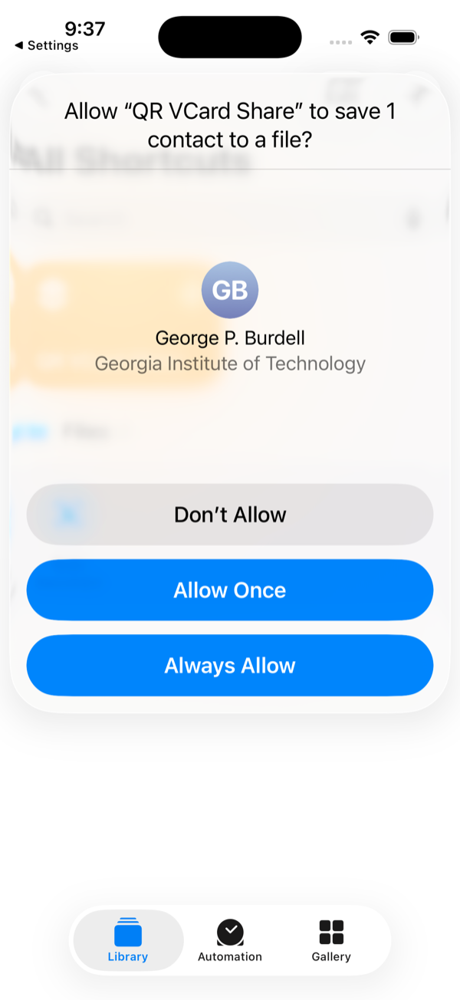

# QR VCard Share

QR VCard Share is an Apple Shortcut that encodes a contact card as a vCard 3.0 QR code for on-screen
display, or exports it as a `.vcf` file through the system share sheet. The fields and entries
included are determined by user-defined sharing profiles. It is written in
[Cherri](https://cherrilang.org) and compiled to a signed Shortcuts file.

  
   
  Opens in the Shortcuts app on iPhone, iPad or Mac

  
  &nbsp;&nbsp;
  

Example output for two fictitious contacts under the Business and Personal profiles.

## Features

- **Display.** Renders a contact as a QR code with the encoded details printed below it, so the
  person sharing and the person scanning see the same information. The QR code is scannable with a
  phone's built-in camera; no app is required on the receiving device.
- **Export.** Produces a `.vcf` file for the share sheet (Messages, AirDrop, Mail, etc.). A
  plain-text preview of the file's complete contents is shown for confirmation first.
- **Profiles.** Named profiles specify which categories of information to include and, for phone
  numbers, email addresses and postal addresses, which entries by their Contacts label. Profiles can
  be added, edited, renamed and deleted.
- **Label preservation.** Entries keep their Contacts types (mobile, work, home) and custom labels in
  the exported vCard, so the recipient's address book files them under the same labels.
- **Minimal prompting.** The user is prompted only when a contact has entries in a category but none
  match the profile. The choice is retained per contact and profile for later runs.

## Requirements

- iOS, iPadOS or macOS with the Shortcuts app. Tested on iOS 26 and macOS 26.
- iCloud Drive enabled. Settings are stored in the Shortcuts folder in iCloud Drive.
- Access to Contacts, granted when Shortcuts first requests it.

## Installation

1. Open the [iCloud link](https://www.icloud.com/shortcuts/1d1f4fd12e604cc78eaccd6727e44b62) on the
   target device and select **Add Shortcut**.

   

2. Run the shortcut and select **Set your Identity**, then choose your own contact card.

Run Set your Identity on the device you will use most; the shortcut's settings are created there. To
use it on additional devices as well, see [Known limitations](#known-limitations).

On first use, Shortcuts requests permission to read and write files in iCloud Drive and to save
contact data to a file. Selecting **Always Allow** reduces subsequent prompts; see
[Known limitations](#known-limitations).

## Usage

  
  
  

| Menu item | Function |
|---|---|
| Show my QR VCard | Displays the user's card as a QR code under the selected profile. |
| Show a contact's QR VCard | Displays a selected contact's card as a QR code under the selected profile. |
| Share my VCard | Previews, then exports the user's card as a `.vcf` file. |
| Share a contact's VCard | Previews, then exports a selected contact's card as a `.vcf` file. |
| Set your Identity | Stores a copy of the user's own contact card. Re-run after editing that card. |
| Manage profiles | Adds, edits, renames or deletes profiles. |

### Profiles

Four profiles are created on first run:

| Profile | Included information |
|---|---|
| Business | Company, job title, department, work phone, work email |
| Personal | Mobile phone, home email, home address, birthday |
| Cell only | Mobile phone |
| Everything | All supported fields and entries |

Editing a profile takes two steps. The first selects categories: company, job title, department,
birthday, phone numbers, email addresses and addresses. The second selects, for each of the last
three, which labels to include:

| Category | Available labels |
|---|---|
| Phone numbers | primary, all, mobile, iPhone, work, home, main, pager, other |
| Email addresses | primary, all, home, work, other |
| Addresses | primary, all, home, work, other |

Custom labels present on the user's own card (for example "Lab") are offered as additional options.
"Primary" refers to the entry Contacts marks as preferred. An entry is included if it matches any
selected label, so two entries with the same label are both included.

  
  

### Selection behavior

For a given contact and profile:

- **Single-value fields:** company, job title, department and birthday are included when selected
  in the profile and present on the card. Absent fields are omitted without a prompt.
- **Phone numbers, emails and addresses:** entries whose labels match the profile are included
  without a prompt.
- **No match:** if the card has entries in a category but none match, the user selects the entries
  to include. The selection is retained for that contact and profile.
- **Changed labels:** a retained selection is discarded for a category when that category's labels
  are later changed in the profile, and the user is prompted again for that category only.
- **Manual selection:** **Pick items manually…** in the profile list prompts for every category and
  replaces any retained selections.

### Export preview

Before a `.vcf` file is exported, the shortcut displays its complete contents in plain text with
**OK** and **Cancel**. The display mode needs no separate preview because the printed text matches
the encoded QR code.

## Quick access

The shortcut can be started from any of the places iOS, iPadOS and macOS run shortcuts:

| Method | Setup |
|---|---|
| Home Screen | In Shortcuts, touch and hold QR VCard Share, then select **Share** → **Add to Home Screen**. |
| Widget | Add the **Shortcuts** widget to the Home Screen or Lock Screen and select QR VCard Share or a folder containing it. |
| Control Center | Edit Control Center, select **Add a Control** → **Shortcut**, and select QR VCard Share. |
| Action Button | On iPhone models with an Action Button: Settings → Action Button → **Shortcut** → QR VCard Share. |
| Back Tap | Settings → Accessibility → Touch → Back Tap → Double Tap or Triple Tap → QR VCard Share. |
| Siri | Say "QR VCard Share". |
| Mac | In Shortcuts on the Mac, the shortcut's details offer **Pin in Menu Bar** and a keyboard shortcut. |

Each of these opens the main menu.

### Launching directly into a profile

QR VCard Share accepts a text command as input that skips the main menu:

| Input | Effect |
|---|---|
| `show:<profile>` | Displays the user's card with the named profile, e.g. `show:Business`. |
| `share:<profile>` | Previews and exports the user's card with the named profile. |
| `show-contact:<profile>` | Prompts for a contact, then displays it with the named profile. |
| `share-contact:<profile>` | Prompts for a contact, then previews and exports it with the named profile. |

The profile name must match exactly, including capitalization. If it is omitted (`show`) or does not
match an existing profile, the profile list is shown instead. Without input, the shortcut opens the
main menu.

To create a one-tap launcher for a profile:

1. In Shortcuts, create a new shortcut.
2. Add a **Text** action containing the command, for example `show:Business`.
3. Add a **Run Shortcut** action, select QR VCard Share, and set its input to the Text action.
4. Rename the shortcut (for example "Business card") and assign it to the Home Screen, a widget,
   Control Center, the Action Button, Back Tap or Siri as described above.

## Data storage and privacy

The shortcut stores data only in the Shortcuts folder in the user's iCloud Drive, under `QRVCard/`,
which iCloud syncs across the user's devices. It sends contact data to other apps or people only
when the user confirms an export.

| Path | Contents |
|---|---|
| `identity.vcf` | Copy of the user's own contact card, written by Set your Identity. |
| `profiles/order.txt` | Profile identifiers, in menu order. |
| `profiles/<id>.json` | One profile: name, categories and label selectors. |
| `cache/<profile id>/<contact hash>.json` | Retained selections for one contact and profile. |
| `picked_contact.vcf` | Temporary copy used to read a selected contact; cleared immediately after use. |

Retained selections do not contain contact details. Contacts are identified by a SHA-256 hash of
their vCard name field, and selections are stored as SHA-256 hashes of the chosen vCard lines.
Because the space of phone numbers is small, these hashes can be reversed by exhaustive search and
should be regarded as obfuscation rather than encryption.

## Known limitations

- **iCloud Drive is required.** Without it the shortcut stops with "Location doesn't exist". The
  key-value storage actions introduced in iOS/macOS 27 may remove this requirement in a later
  version.
- **Settings created on another device.** iCloud Drive can keep files written on one device as
  online-only placeholders on another until they are opened, and Shortcuts does not download them:
  the shortcut stops with "The file … couldn't be opened". Either use the shortcut mainly on one
  device, or on each additional device open the Files app, go to iCloud Drive → Shortcuts, touch and
  hold the **QRVCard** folder and select **Keep Downloaded** (iOS 18 and later).
- **Identity is a snapshot.** Edits to the user's own contact card take effect after Set your
  Identity is run again.
- **Repeated permission prompts.** Shortcuts may request permission to save contact data to a file
  for each contact not previously processed, even after **Always Allow** is selected.

  

- **Updating the shortcut.** On iOS 26 and macOS 26, the **Replace** option in the Shortcuts import
  dialog adds a second copy instead of replacing the existing one. Delete the existing shortcut
  before adding a new version. Stored settings are unaffected.

## Building from source

The shortcut is compiled with a patched build of Cherri. Build, test and release procedures, the
source layout and a list of Shortcuts and Cherri behaviors the implementation works around are
documented in [docs/DEVELOPMENT.md](docs/DEVELOPMENT.md).

## Author

Jeff Wilson ([@gtjeffw](https://github.com/gtjeffw)), Georgia Institute of Technology

## License

Released under the [MIT License](LICENSE), with the exception of the Cherri patches in
[patches/cherri/](patches/cherri/), which are licensed under GPL-2.0 in accordance with Cherri's
license.
